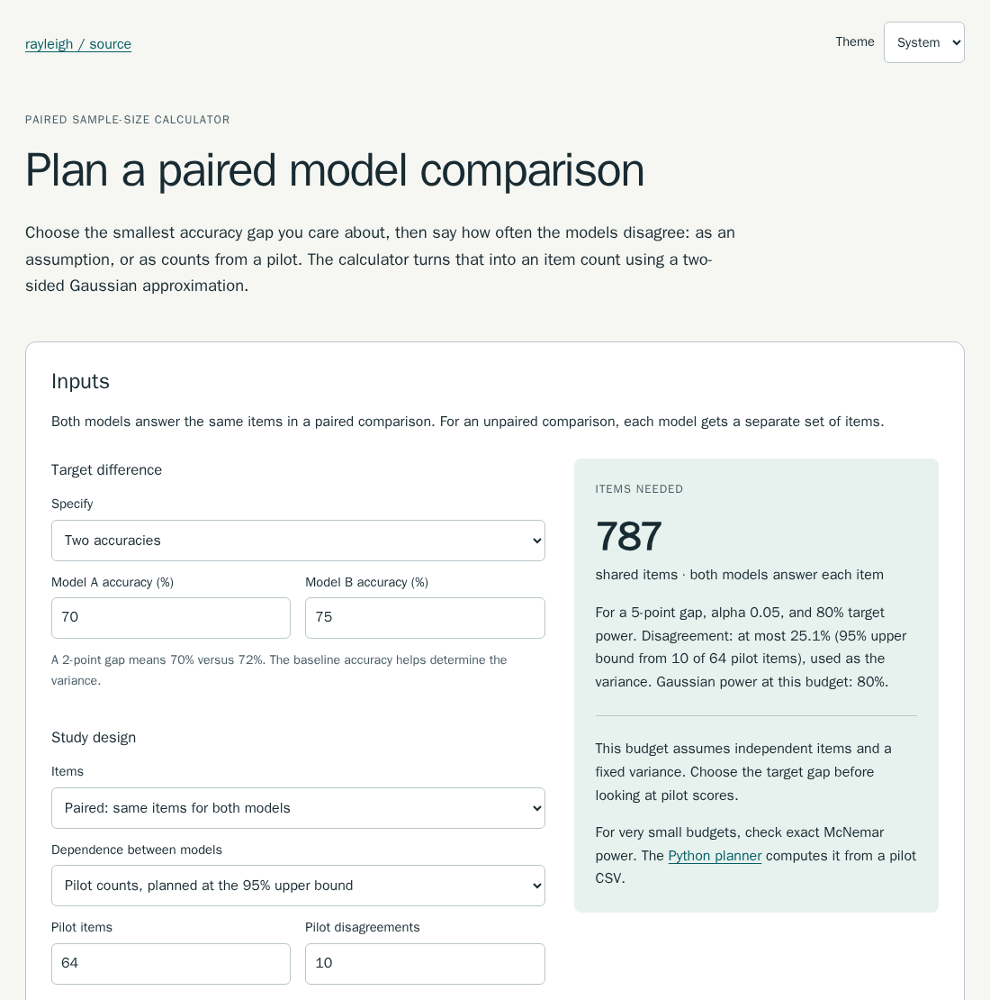
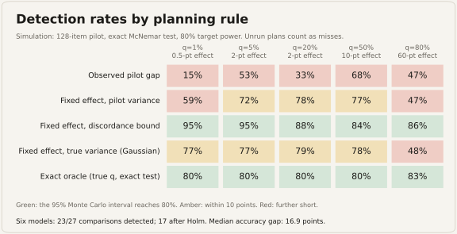
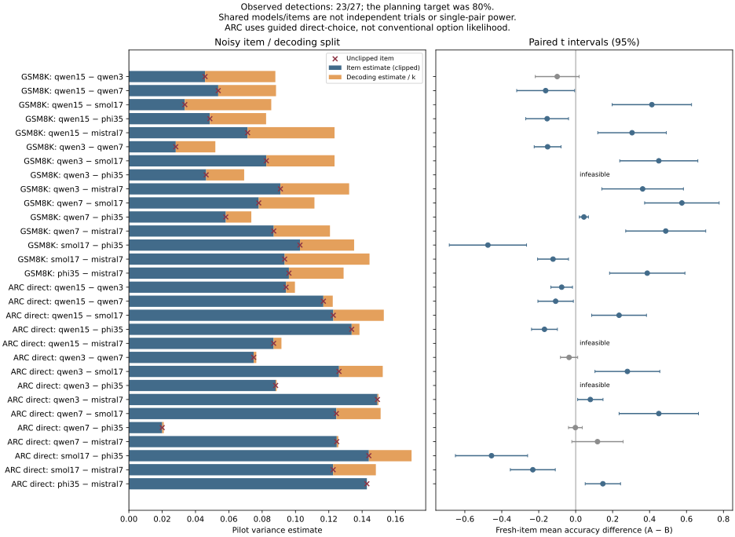

# rayleigh

rayleigh is a sample-size calculator for comparing two LLMs on the same benchmark questions, with a [browser version](https://mottopanikeiku.github.io/rayleigh/) for quick what-ifs and a Python planner that reads your pilot scores.

[](https://mottopanikeiku.github.io/rayleigh/)

You give it the smallest accuracy gap you care about and how often the two models disagree (one right, the other wrong). Disagreement drives the variance of a paired comparison, so two models that tend to miss the same questions need fewer of them to tell apart.

## From a pilot

Score both models on a few dozen shared questions and save one row per question: `item_id`, `model_a`, `model_b`, each 0 or 1. The example is 64 GSM8K questions answered greedily by Qwen2.5-7B and Phi-3.5-mini.

```sh
uv sync --locked
uv run rayleigh --difference 0.05 --pilot examples/gsm8k_qwen7_phi35_pilot.csv
```

`--difference 0.05` asks for a five-point gap, and the JSON it prints ends with the budgets in questions per model:

```text
"paired_items_per_model": 496,
"bound_items_per_model": 787,
"unpaired_items_per_model": 611
```

The paired budget plugs in the pilot's disagreement rate as is, while the bound budget uses a 95% upper bound on it, which costs more questions and protects you from a pilot that happened to see too few disagreements. From Python the import name is `eval_power`, and since the `rayleigh` package on PyPI is unrelated, install from this checkout:

```python
from eval_power import discordance_upper_bound, read_paired_csv, required_items

item_ids, scores = read_paired_csv("examples/gsm8k_qwen7_phi35_pilot.csv")
discordant = int((scores[:, 0] != scores[:, 1]).sum())
n = required_items(0.05, discordance_upper_bound(discordant, len(item_ids)))  # 787
```

[`examples/plan_from_pilot.py`](examples/plan_from_pilot.py) also checks exact power at the pilot's disagreement rate, which is 78% for 496 questions and 94% for 787. The [browser calculator](https://mottopanikeiku.github.io/rayleigh/) does the bound plan too: choose pilot counts, enter 64 items with 10 disagreements, and a 5-point gap needs the same 787.

## Choosing a planning rule

Decide the smallest gap you'd care about before looking at any data, and let the pilot estimate only how often the models disagree, since that rate decides which rule to use:

| Situation | Rule | Power with a 128-question pilot |
|---|---|---|
| Models disagree on 20% of questions or more | target gap, pilot's disagreement rate | 77–78% |
| Models disagree on 5% or fewer | target gap, 95% upper bound on disagreement | about 95%, versus 59–72% without the bound |
| Tiny budgets | exact McNemar power | a 10-question Gaussian plan had 48% power; exact says 18 |

The bound can price you out, though: at 1% disagreement and a 32-question pilot, every bound plan wanted more than 20,000 questions.

Those power figures come from simulating five paired designs with known truth. The figure also includes the shortcut of planning around whatever accuracy gap the pilot showed, which with 128-question pilots and an 80% target found the real difference only 15–68% of the time.

<picture><source media="(prefers-color-scheme: dark)" srcset="docs/hero-dark.svg"></picture>

Each column is one design, with q the share of questions on which exactly one model is right and the effect the true accuracy gap. A budget that can't be planned counts as a miss.

## On real models

Six small models (Qwen2.5 1.5B, 3B and 7B, SmolLM2 1.7B, Phi-3.5-mini, Mistral-7B-v0.3) answered GSM8K and ARC-Challenge. A 64-question pilot planned each comparison, and fresh questions found a difference in 23 of 27. The gaps were large (median 17 points), so this is a sanity check rather than a test of the hard cases.



In a separate analysis of 54,985 historical Chatbot Arena votes, only 4 of 54 adjacent model pairs had a 95% interval that excluded zero.

## Tests

```sh
uv run pytest -q tests site/test_fixture.py
node --test site/*.test.mjs
uv run python scripts/check_results.py    # recompute every table and compare with the saved files
```

Simulation design, exact power, the six-model protocol, the Arena analysis and references are in [docs/method.md](docs/method.md). Benchmark response data comes from tinyBenchmarks and Chatbot Arena, with sources and licenses in [`data/`](data), and the code is MIT licensed.
