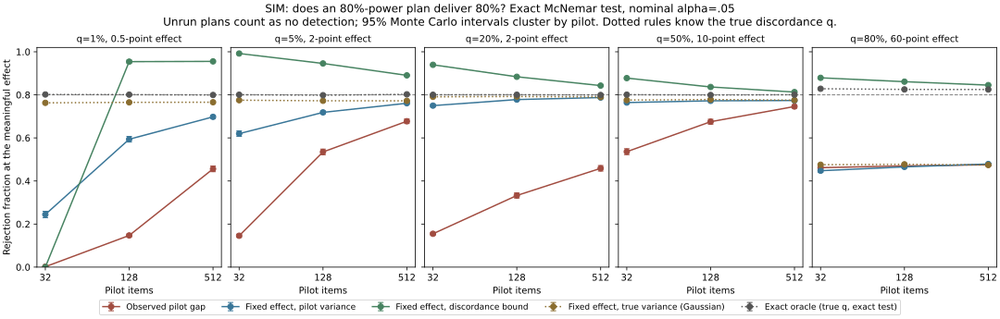

# rayleigh

How many shared questions do I need to distinguish two models, and which way of choosing that number actually delivers the power it promises?

<picture><source media="(prefers-color-scheme: dark)" srcset="docs/hero-dark.svg"></picture>

[Try my power calculator](https://mottopanikeiku.github.io/rayleigh/) · [Calibration methods and every number](docs/CALIBRATION.md) · [Prior work and citations](docs/PRIOR_WORK.md)

I checked five ways of turning a paired pilot into an "80%-power" item count against simulated evaluations where I know the truth. Each rule in each design runs 96,000 exact McNemar tests on fresh simulated items. At a 128-item pilot, **planning from the pilot's observed gap detected the meaningful effect 15–68% of the time**. Fixing the effect in advance and plugging in the pilot variance reached 77–78% when at least 20% of items were discordant, but 72% at 5%, 59% at 1% and 47% for a 10-item design. **Replacing the variance with a 95% upper bound on the discordance rate delivered 84–95% in every design**, at 1.2–2.4 times the median plug-in budget. These are simulations (SIM), not model measurements.

## Which planning rule to trust, when

SIM, from [`results/known_truth/nested.csv`](results/known_truth/nested.csv) at a 128-item pilot unless stated; q is the share of items on which the two models disagree.

| Situation | Plan with | What the simulation shows |
|---|---|---|
| Always | A meaningful effect fixed before the pilot, never the pilot's observed gap | Observed-gap plans detected 15–68%, and still only 46–75% with 512-item pilots. |
| Discordance common (q ≥ 20%) and budgets of hundreds of items | Plug-in pilot variance (`paired_items_per_model`), expecting 2–3 points below target | 77–78%. Even the true variance gives only 78–79%, because the Gaussian formula is short for the exact test: 4,016 items instead of 3,917 at q=20%, 408 instead of 385 at q=50%. |
| Discordance rare (q ≤ 5%) | The discordance bound (`bound_items_per_model`) | 95% versus 59–72% for plug-in variance, at 1.9–2.4 times the median budget. With q=1% and a 32-item pilot every bound plan exceeded my 20,000-item cap: the pilot cannot plan. |
| Budgets under about 30 items | Exact power (`exact_mcnemar_power`), not a Gaussian formula | With q=80% and a 60-point effect, the true-variance Gaussian budget of 10 items has 48% exact power; the exact search needs 18 items. |
| Several comparisons | A multiplicity-adjusted family | In a three-test Holm family, exact-oracle plans fall from 80–83% to 75–78%. |

The Gaussian budget uses the alternative variance q − δ² for both quantiles, while McNemar's statistic has null variance q; at 10 items that mismatch accounts for most of the shortfall (15 items with the null variance, 73% power) and discreteness for the rest. Null rows keep every rule at or below the 5% level, because plans never see the heldout data. I describe the design, Monte Carlo errors, type S errors and a shared-model dependence panel in [the calibration methods](docs/CALIBRATION.md).



## The measured experiment, with its multiplicity and effect sizes

I generated **13,830 answers from six small language models** and confirmed planned comparisons on fresh GSM8K and ARC items (MEAS, [`confirmation_sensitivity.json`](results/known_truth/confirmation_sensitivity.json)):

| Count | Detected | Family |
|---|---:|---|
| Prespecified nominal tests, p < .05 | **23 / 27** | each executed comparison alone |
| Holm, all planned pairs | **17** | 30 planned, the 3 unrun plans as p = 1 |
| Holm, executed only | 18 | 27 executed |
| Holm, one family per benchmark | 19 | 15 planned per benchmark |

| Realized absolute gap | ≤ 1 pt | 1–5 pts | 5–10 pts | 10–20 pts | > 20 pts |
|---|---:|---:|---:|---:|---:|
| Comparisons | 1 | 2 | 3 | 8 | 13 |

The median realized gap is **16.9 points** (quartiles 11.3 and 40.0), and 9 of 27 comparisons used the protocol's 16-item minimum. These confirmations mostly test large separations; they do not validate one-point budgets. The protocol planned from each pilot's observed gap, the rule the simulation says not to trust for close models. Under each plan's own pilot estimates, the item-level t-test has 76–80% power above the 16-item minimum and at least 83% at it; those plug-in powers sum to 22.8 expected detections. All 23 detections have the pilot's sign. The Holm families are post hoc: the protocol prespecified nominal tests.

Each model answered the same 64 pilot questions per benchmark once greedily and five times at temperature 0.7. I used Qwen2.5 1.5B, 3B and 7B, SmolLM2 1.7B, Phi-3.5-mini and Mistral-7B-v0.3: six checkpoints across four families, with revisions and licenses in the [protocol](results/prospective/protocol.json). Qwen's 3B checkpoint has a noncommercial research license.

| Benchmark / decoding task | Median estimated decoding share at k=5 | Median questions for a hypothetical 1-point gap, k=1 → k=5 | Fresh detections |
|---|---:|---:|---:|
| GSM8K, free-form numeric answers | 33.2% | 20,147 → 8,743 | 13 / 14 |
| ARC-Challenge, guided direct choice | 4.6% | 11,371 → 10,864 | 10 / 13 |

I report [every pair, variance estimate, question count, p-value and interval](results/prospective/summary.json). The one-point counts assume a two-sided 5% test and an 80% normal-approximation target. I describe the variance calculation, pilot changes and collection costs in [the methods](docs/PRIOR_WORK.md#5-repeated-answers-and-preference-votes).


## Plan your own comparison

Put one row per shared item in a CSV with exactly the columns `item_id`, `model_a` and `model_b`; scores are 0 or 1. Items are matched by ID within one table, never by row position across files, and duplicate IDs, blanks or non-binary scores are errors. The example is the GSM8K pilot for Qwen2.5-7B (A) and Phi-3.5-mini (B), greedy answers, from this repository's committed outputs.

```bash
uv sync --locked
uv run rayleigh --difference 0.05 --pilot examples/gsm8k_qwen7_phi35_pilot.csv
```

The JSON output lists its assumptions; the planning lines are:

```text
"pilot_n": 64,
"discordant_items": 10,
"paired_items_per_model": 496,
"bound_items_per_model": 787,
"unpaired_items_per_model": 611
```

The same plan from Python, with an exact-power check at the pilot's discordance rate ([`examples/plan_from_pilot.py`](examples/plan_from_pilot.py)):

```text
$ uv run python examples/plan_from_pilot.py
pilot: 64 shared items, 10 discordant, gap -0.031
items per model: plug-in variance 496, discordance bound 787
exact power at q=0.156, 5-point gap, plug-in budget of 496: 0.781
exact power at q=0.156, 5-point gap, bound budget of 787: 0.939
```

The installable distribution is `eval-power` and the import package is `eval_power`; the command is `rayleigh` (`eval-power` also works). The PyPI name `rayleigh` belongs to an unrelated project, so install from this repository: `pip install git+https://github.com/mottopanikeiku/rayleigh`. The [calculator](https://mottopanikeiku.github.io/rayleigh/) implements the same Gaussian planner in the browser.

## Human preferences: adjacent ranks are usually unresolved

I also analyzed a [historical Arena vote release](data/arena_manifest.json). After an exposure filter, 54,985 votes cover 55 models. Only **4/54 adjacent contrasts** exclude zero under either pointwise Wald or bootstrap 95% intervals. Their median fitted 80%-power requirement is **3.30 million total network votes**, not direct-match votes.


For 12 score-independent planning pairs, 200 resamples each from disjoint held-out vote counts produced a median rejection fraction of 96.25%, ranging from 9% to 100%. I report [all pairs and assumptions](results/arena/summary.json).

## Reproduce

I analyze the saved outputs without model downloads. `check_results.py` regenerates the known-truth benchmark and requires every table, the calibration figure, the hero and the CSV example to match the committed files.

```bash
uv sync --locked
uv run python scripts/calibrate.py
uv run python scripts/hero.py
uv run python scripts/prospective_analysis.py
uv run python scripts/arena.py --bootstrap 500 --trials 200
uv run python scripts/check_results.py
uv run pytest
```

To cite this work, use [`CITATION.cff`](CITATION.cff); changes are in the [changelog](CHANGELOG.md).

## Limits

- The calibration is a simulation of IID binary items, the exact McNemar test and three-pair families of independent pairs. It does not calibrate the repeated-decoding t-test, clustered items, prompt variation, adaptive stopping or model selection. One shared-model panel checks familywise error at fixed sizes only.
- The discordance bound is conservative, not optimal: with 512-item pilots it delivered 81–96% at up to twice the plug-in budget, and it plans for nominal, not familywise, power.
- The one-point budgets are hypothetical, not tested one-point effects. Here k=1 means one stochastic draw, not greedy decoding. Fewer questions with k=5 does not imply fewer generated answers or lower GPU cost.
- These are small instruction-tuned models on public benchmarks, so contamination is possible. A 64-question pilot can misestimate effects and variance components. I changed grading and ARC generation before confirmation; ARC uses guided direct choice, not conventional option-likelihood evaluation.
- Comparisons sharing a model reuse answers. The protocol prespecified no multiplicity correction; the Holm counts above are post hoc sensitivity analyses. I left plans above the 512-question collection limit unrun.
- Arena results are historical resamples, not newly collected votes or a current leaderboard. Its IID, transitive Bradley–Terry model cannot recover unavailable user/prompt clustering; adjacent intervals are neither simultaneous nor selection-adjusted.
- My [earlier single-answer analysis](results/calibration.csv) and calculator remain separate from the repeated-decoding experiment.

Written with AI coding assistance.
