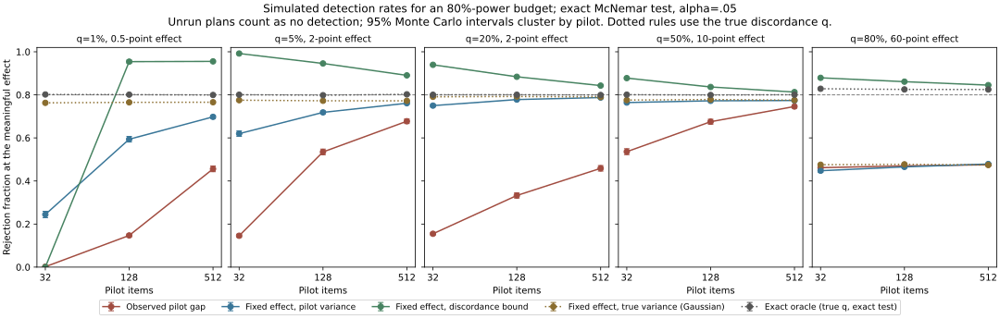

# Planning a paired evaluation

A pilot can give a precise-looking item count and still leave the evaluation underpowered. I compared five sample-size rules in binary-outcome simulations, using an exact two-sided McNemar test to measure how often each rule detected the target gap.

## Results at a 128-item pilot

Here q is the fraction of items on which exactly one model is correct. Every rule targets 80% power at alpha 0.05. Rates include plans that could not run: an undefined budget or one above 20,000 items counts as no detection.

| Discordance and target gap | Observed pilot gap | Fixed gap, pilot variance | Discordance bound | True variance, Gaussian | Exact test, true q |
|---|---:|---:|---:|---:|---:|
| q=1%, gap=0.5 points | 14.7% | 59.4% | 95.4% | 76.5% | 80.1% |
| q=5%, gap=2 points | 53.5% | 71.8% | 94.6% | 77.2% | 79.8% |
| q=20%, gap=2 points | 33.3% | 77.8% | 88.4% | 79.2% | 80.1% |
| q=50%, gap=10 points | 67.5% | 77.2% | 83.6% | 77.8% | 79.9% |
| q=80%, gap=60 points | 47.0% | 46.5% | 86.1% | 47.7% | 82.5% |

Source: [`nested.csv`](../results/known_truth/nested.csv). The file also includes 32- and 512-item pilots, zero and half-target effects, item counts, Monte Carlo intervals and Holm-adjusted results.

Fix the target gap before looking at the pilot. Pilot variance comes close to the power target when disagreement is common and the budget is large. For rare disagreement, the upper bound on discordance buys substantially more power at a larger item count.

At q=1%, 785 of 3,000 fixed-gap plans had no discordant pilot items and therefore no variance estimate usable by the planner. Their overall detection rate was 59.4%, even though the plans that ran reached 80.4%. The bound's median budget was 11,467 items, versus 4,867 for the pilot-variance rule; 129 bound plans exceeded the cap. With a 32-item pilot, every bound plan in this design exceeded 20,000 items.

Larger pilots did not fix observed-gap planning. At 512 items, that rule still detected only 45.6–74.6% of target effects. The bound reached 81.3–95.5%, at 1.1–2.1 times the median pilot-variance budget.

## Simulation design

For binary outcomes A and B, define δ = E[A−B] and q = P(A≠B). The probabilities of the four outcomes 00, 01, 10 and 11 are:

$$
(1-q)/2,\quad (q-\delta)/2,\quad (q+\delta)/2,\quad (1-q)/2.
$$

This gives Var(A−B) = q−δ². The five designs use the q and target-gap combinations in the table. Each runs at a true effect of zero, half the target and the target, with pilot sizes 32, 128 and 512.

Each of 1,000 outer repetitions draws pilots for three independent model pairs. Each pilot chooses a budget, then 32 independent evaluation samples test that budget. That gives 96,000 tests per rule, design, effect and pilot size. Rules share pilots and use separate evaluation streams. The random seed is 20261029, using NumPy PCG64; [`configuration.json`](../results/known_truth/configuration.json) contains the settings and seed derivation.

### Planning rules

| Result-file name | Budget calculation |
|---|---|
| `observed_gap` | Gaussian planner using the absolute pilot gap and unbiased sample variance |
| `fixed_effect` | Gaussian planner using the fixed target gap and pilot variance |
| `discordance_bound` | Fixed target gap and a one-sided 95% Clopper–Pearson upper bound on q, used as the variance |
| `known_variance` | Fixed target gap and true variance q−target² in the Gaussian planner |
| `exact_oracle` | Smallest item count whose exact McNemar power reaches 80% at the true q and target gap |

The discordance bound uses Var(A−B) ≤ q. It needs only the pilot's discordance count and remains defined when that count is zero. This applies Browne's upper-confidence-limit approach to pilot variance [1] to binary pairs. The CLI calls the resulting budget `bound_items_per_model`.

Zero-gap and zero-variance plug-in plans are undefined. Budgets above 20,000 are left unrun. The results give both overall detection rates and rates conditional on running a plan, plus counts for each status. Unrun comparisons receive p=1 in the three-test Holm family.

Monte Carlo standard errors and approximate 95% intervals cluster by outer repetition, since 32 evaluation samples share each pilot. Conditional rates use a ratio-of-means delta method. Fixed-size and shared-model simulations use Wilson intervals. These intervals measure simulation uncertainty.

### Exact power

`exact_mcnemar_power(delta, discordance, n, alpha)` averages over the discordance count M ∼ Binomial(n,q). Conditional on M=m, the number of A-only successes follows Binomial(m,(q+δ)/(2q)). It sums the probability of the exact two-sided McNemar rejection region, including p-values equal to alpha.

[`reference.csv`](../results/known_truth/reference.csv) compares this calculation with 20,000 simulated evaluations at each fixed size. Its Bonferroni column uses alpha/3. The exact wrong-sign detection probability peaks at 0.79% in the reference grid, where total power is 2.7%.

## Why Gaussian budgets can fall short

The Gaussian planner uses q−δ² for both normal quantiles. McNemar's null variance is q. Using q for the alpha quantile and q−δ² for the power quantile gives the middle column below; this is a direct normal-approximation calculation. Connor [2] studies the related gap between approximate and exact paired-proportion power.

| Discordance and target gap | Gaussian, true variance | Null-variance Gaussian | Exact test, true q |
|---|---:|---:|---:|
| q=1%, gap=0.5 points | 3,132 items; 76.5% | 3,138; 76.6% | 3,373; 80.0% |
| q=5%, gap=2 points | 974; 77.3% | 979; 77.5% | 1,035; 80.0% |
| q=20%, gap=2 points | 3,917; 79.0% | 3,923; 79.1% | 4,016; 80.0% |
| q=50%, gap=10 points | 385; 77.6% | 391; 78.3% | 408; 80.0% |
| q=80%, gap=60 points | 10; 47.5% | 15; 72.9% | 18; 82.6% |

At large budgets, the exact test's discreteness costs about 1–3.5 percentage points of power. At ten items, the variance mismatch accounts for most of the shortfall. Exact power can fall when n increases by one, so check nearby budgets with `exact_mcnemar_power` when planning a small study.

## Several comparisons

Every rule kept its null detection rate below 5% in the simulation. The largest was 4.69% with a 95% Monte Carlo interval of 4.56–4.82%. Across three independent null comparisons, the chance of at least one false positive reached 13.4%; Holm kept it below 4.8%.

The bound and other planners target one comparison at a time. For q=20%, a two-point gap and a 128-item pilot, fixed-gap planning detected 77.8% of effects before correction and 72.4% after Holm.

A separate simulation in [`shared_models.csv`](../results/known_truth/shared_models.csv) tests three pairs sharing three models and the same items. Half the items are easy and half hard, with conditional correctness probabilities 0.8 and 0.2. A second design raises one model's probabilities by 0.1. At 1,024 items under the global null, the chance of any false positive was 11.0% before correction and 3.77% after Holm.

## Six-model experiment

The [repeated-answer experiment](PRIOR_WORK.md#repeated-answers) used paired t-tests on item means. Of 27 comparisons run on new questions, 23 detected a difference at p<0.05, all in the direction seen in the pilot. Three more plans exceeded the collection limit. Applying Holm afterwards gives 17 detections across all 30 planned comparisons, 18 across the 27 run, or 19 with a separate 15-pair family for each benchmark.

The median absolute gap was 16.9 percentage points, with quartiles of 11.3 and 40.0. Only one comparison had a gap of at most one point, and nine used the 16-item minimum. [`confirmation_sensitivity.json`](../results/known_truth/confirmation_sensitivity.json) contains each gap, adjusted p-value and item count.

Those plans used observed pilot gaps. Under each plan's own gap and variance estimates, t-test power was 76.4–79.8% for the 18 plans above the minimum and at least 83.0% for the nine at it. The sum was 22.8 expected detections. These calculations depend on the pilot estimates being correct.

## Recompute

After `uv sync --locked`, `uv run python scripts/calibrate.py` regenerates the tables and calibration figure without model downloads. `uv run python scripts/hero.py` draws the README image from the result files.

CI runs `uv run python scripts/check_results.py` on x86-64 and arm64. It recomputes the tables, allows relative floating-point differences of 1e-12, and compares the generated figures and example CSV with the saved files. It also checks simulated rates against exact power, null error rates, Holm families and plan counts.

## Limitations

- Items are independent and binary. The simulation does not cover clustered prompts, repeated-decoding t-tests, adaptive stopping or model selection.
- The bound is conservative and still uses a Gaussian budget. Its success in these five designs is not an exact-power guarantee for other settings.
- Power targets apply to individual comparisons. The shared-model experiment covers one dependence structure at fixed sizes.
- The six-model experiment mostly contains large accuracy gaps and used a different planning rule and test.

## References

1. Richard H. Browne. 1995. *On the use of a pilot sample for sample size determination*. Statistics in Medicine 14(17):1933–1940. [PubMed](https://pubmed.ncbi.nlm.nih.gov/8532986/).
2. Robert J. Connor. 1987. *Sample size for testing differences in proportions for the paired-sample design*. Biometrics 43(1):207–211. [PubMed](https://pubmed.ncbi.nlm.nih.gov/3567305/).
